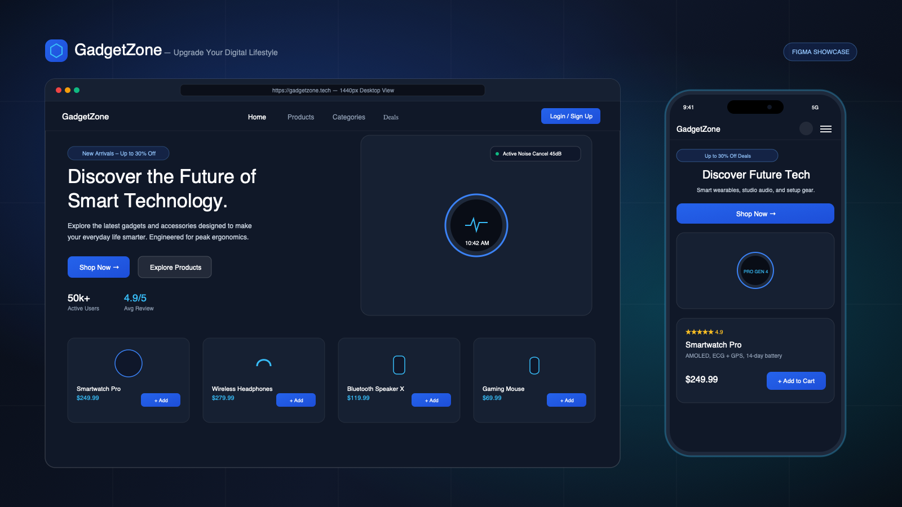
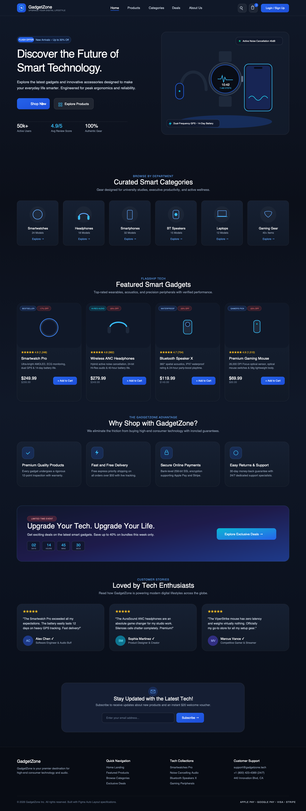
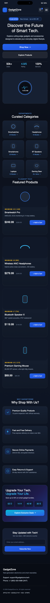
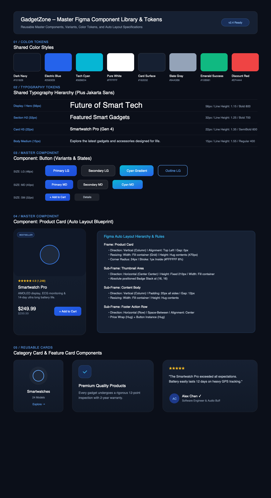

<div align="center">

  # ⚡ GadgetZone – Upgrade Your Digital Lifestyle
  ### Modern, Attractive & Fully Responsive E-Commerce Product Landing Page

  [](https://figma.com)
  [](#)
  [](#)
  [](#)
  [](#)
  [](#)

  <br />

  

  <p align="center">
    <b>A high-converting, modern e-commerce storefront designed for smart gadgets, studio audio, and performance peripherals.</b>
    <br />
    Compliant with strict <b>Figma 1440px Desktop</b> and <b>390px Mobile</b> Auto Layout specifications.
  </p>

</div>

---

## 📑 Table of Contents

- [Project Overview](#-project-overview)
- [Visual Previews](#-visual-previews)
  - [Desktop View (1440px)](#1-desktop-landing-page-1440px)
  - [Mobile View (390px)](#2-mobile-landing-page-390px)
  - [Design System & Components Library](#3-figma-components--tokens-library)
- [Target Audience & User Personas](#-target-audience--user-personas)
- [Design System & Tokens](#-design-system--tokens)
  - [Color Palette](#color-palette-tokens)
  - [Typography Hierarchy](#typography-scale)
  - [8pt Grid & Spacing](#8pt-grid--spacing-system)
- [Reusable Figma Components](#-reusable-figma-components)
- [Website Sections Breakdown](#-website-sections-breakdown)
- [Project Structure](#-project-structure)
- [How to Run Locally](#-how-to-run-locally)
- [How to Push to GitHub](#-how-to-push-to-github)
- [License](#-license)

---

## 🚀 Project Overview

**GadgetZone** is a fictional smart gadgets and consumer electronics brand dedicated to upgrading the digital lifestyles of students, professionals, creators, and gamers.

The platform provides an engaging online shopping experience, rapid product discovery, and friction-free conversion pathways with:
- **Interactive Header & Drawer**: Navigation with search modal autocomplete and active cart drawer.
- **Hero Section**: Promotional badge (*"New Arrivals – Up to 30% Off"*), high-tech vector showcase, and dual CTAs.
- **Curated Category Grid**: 6 distinct departments with dedicated explore triggers.
- **Flagship Featured Products**: 4 top-rated gadget cards with live cart calculations and Quick-View modal.
- **Value Proposition**: 4 key trust cards (12-point quality inspection, 2-day free shipping, 256-bit encryption, 30-day returns).
- **Flash Deals Banner**: Live countdown timer with promotional bundle CTAs.
- **Customer Social Proof**: Testimonials with star ratings and verified buyer badges.
- **VIP Newsletter**: Voucher incentive with client-side validation.
- **Comprehensive Footer**: Navigation links, legal disclaimers, payment badges, and 24/7 support information.

---

## 📸 Visual Previews

### 1. Desktop Landing Page (`1440px`)

> Full-width 1440px frame with 12-column responsive grid layout, elevated dark surfaces, and electric blue micro-interactions.

<div align="center">
  
</div>

<br />

---

### 2. Mobile Landing Page (`390px`)

> Mobile-first iPhone 390px frame with dynamic island, status bar, touch-friendly 44px tap targets, 2-column category grid, and 1-column product cards.

<div align="center">
  
</div>

<br />

---

### 3. Figma Components & Tokens Library

> Complete master component sheets with variant matrices, shared color swatches (with hex values), typography scale, and Auto Layout parameter annotations.

<div align="center">
  
</div>

---

## 👥 Target Audience & User Personas

| Persona | Context & Behavior | Needs & Pain Points | Design Solution |
| :--- | :--- | :--- | :--- |
| **University Students** | Cost-conscious, mobile-first, looking for study gear. | Needs transparent pricing, verified discounts, and bundle savings. | Up to 30% Off promo badge, strike-through pricing, and instant $20 newsletter voucher. |
| **Working Professionals** | Remote/hybrid executives focused on daily productivity. | Prioritizes build quality, hybrid ANC, and fast shipping. | "Why Choose Us" cards highlighting 2-day express delivery, 2-year warranty, and premium materials. |
| **Tech Enthusiasts** | Early adopters obsessed with hardware specifications. | Demands detailed specs (AMOLED nits, GPS, driver size, battery hours). | Quick-View spec modal with hardware highlight tags (Dual-Band GPS, 45dB ANC, 26K DPI). |
| **Gamers & Streamers** | Competitive esports players requiring low latency. | Wants featherlight ergonomics, zero input lag, and responsive switches. | Dedicated Gaming Gear category, "Gamer's Pick" product badge, and high-contrast visual cues. |

---

## 🎨 Design System & Tokens

### Color Palette Tokens

```
┌────────────────────────────────────────────────────────────────────────┐
│                        SHARED COLOR SYSTEM                             │
├───────────────────┬─────────────┬─────────────┬────────────────────────┤
│ Token Name        │ Hex Code    │ RGB         │ Semantic Role          │
├───────────────────┼─────────────┼─────────────┼────────────────────────┤
│ Primary Navy      │ #101828     │ 16, 24, 40  │ Canvas / Hero Surface  │
│ Dark Background   │ #0B0F19     │ 11, 15, 25  │ Deep Body Background   │
│ Card Surface Dark │ #162032     │ 22, 32, 50  │ Elevated Card Surface  │
│ Electric Blue     │ #2563EB     │ 37, 99, 235 │ Primary Buttons / CTAs │
│ Blue Hover        │ #1D4ED8     │ 29, 78, 216 │ Active / Hover State   │
│ Tech Cyan Accent  │ #06B6D4     │ 6, 182, 212 │ Secondary Glow / Icons │
│ Pure White        │ #FFFFFF     │ 255, 255, 255│ Headings & High Contrast│
│ Muted Slate Gray  │ #94A3B8     │ 148, 163, 184│ Secondary Text / Meta  │
│ Emerald Success   │ #10B981     │ 16, 185, 129│ Stock / Verified Buyer │
│ Discount Red      │ #EF4444     │ 239, 68, 68 │ Price Drops / Badges   │
│ Warning Amber     │ #F59E0B     │ 245, 158, 11│ Star Ratings (4.9★)    │
└───────────────────┴─────────────┴─────────────┴────────────────────────┘
```

### Typography Scale

* **Primary Font**: `Plus Jakarta Sans` (Display & Headings)
* **Secondary Font**: `Inter` (Body, Metadata & Technical Data)

| Figma Style Name | Font Size | Line Height | Weight | Letter Spacing | Usage in UI |
| :--- | :--- | :--- | :--- | :--- | :--- |
| `Display / Hero` | **56px** | 64px (1.15) | Bold (800) | -0.025em | Main Hero Heading ("Discover the Future...") |
| `Heading / H1` | **40px** | 48px (1.20) | Bold (700) | -0.020em | Section Headers & Modal Titles |
| `Heading / H2` | **32px** | 40px (1.25) | Bold (700) | -0.015em | Feature Headers ("Featured Smart Gadgets") |
| `Heading / H3` | **22px** | 30px (1.35) | SemiBold (600) | -0.010em | Product Card Titles ("Smartwatch Pro") |
| `Heading / H4` | **18px** | 26px (1.40) | SemiBold (600) | 0.000em | Feature Card Titles |
| `Body / Large` | **18px** | 28px (1.55) | Regular (400) | 0.000em | Hero Supporting Subtext |
| `Body / Medium` | **15px** | 24px (1.60) | Regular (400) | 0.000em | Testimonials & Card Descriptions |
| `Button / Label` | **14px** | 16px (1.15) | SemiBold (600) | 0.010em | Action Buttons & CTAs |
| `Badge / Caption`| **12px** | 16px (1.33) | Bold (700) | 0.040em | "New Arrivals", "-20% OFF", Tags |

### 8pt Grid & Spacing System

- **Desktop Container**: Max `1280px` content width inside `1440px` frame.
- **Desktop Columns**: 12 Columns, `24px` gutter, `80px` outer margins.
- **Mobile Container**: `350px` content width inside `390px` frame.
- **Mobile Columns**: 4 Columns, `16px` gutter, `20px` outer margins.
- **Spacing Steps**: `4px` (2xs) | `8px` (xs) | `12px` (sm) | `16px` (md) | `24px` (lg) | `32px` (xl) | `48px` (2xl) | `80px` (3xl).

---

## 🧩 Reusable Figma Components

### 1. `Button` Component
- **Variants**: `Primary` (Electric Blue), `Secondary` (Glassmorphic), `Outline` (Border Stroke), `Cyan Gradient`, `Ghost`.
- **Sizes**: `Large` (48px height), `Medium` (40px height), `Small` (32px height).
- **Auto Layout**: Direction Horizontal, Hug contents, `8px` item gap, `12px` corner radius.

### 2. `Product Card` Component
- **Variants**: `Default`, `On Sale`, `Bestseller`, `Hover`.
- **Structure**: Fixed `220px` thumbnail container with badge stack + quick-action buttons; Body with star rating, title, 2-line description clamp, price with strike-through, and `Add to Cart` button.

### 3. `Category Card` Component
- **Variants**: `Default`, `Hover`.
- **Structure**: Vertical Auto Layout, centered circular `80px` icon frame, category name, model count, and animated explore arrow.

### 4. `Feature Card` Component
- **Variants**: `Default`, `Active`.
- **Structure**: Vertical Auto Layout, `56px × 56px` gradient icon container, title, body description, `24px` corner radius.

---

## 💻 Website Sections Breakdown

- **A. Header / Navigation**: Sticky glassmorphic navbar with pulse logo, navigation links, instant search modal trigger, shopping cart badge with live quantity count, and login button.
- **B. Hero Section**: High-impact split grid with *"New Arrivals – Up to 30% Off"* badge, display heading, dual CTAs (*Shop Now* & *Explore Products*), social proof stats (50k+ users, 4.9★ rating), and custom 3D gadget ensemble vector illustration.
- **C. Product Categories**: 6 curated departments (*Smartwatches*, *Wireless Headphones*, *Smartphones*, *Bluetooth Speakers*, *Laptops*, *Gaming Accessories*).
- **D. Featured Products**: 4 benchmarked flagship devices (*Smartwatch Pro*, *Wireless Noise Cancelling Headphones*, *Bluetooth Speaker X*, *Premium Gaming Mouse*) with live Add to Cart, Quick-View spec modal, and discount calculations.
- **E. Why Choose GadgetZone**: 4 core guarantees (*Premium Quality Products*, *Fast & Free Delivery*, *Secure Online Payments*, *Easy Returns & 24/7 Support*).
- **F. Promotional Banner**: High-urgency deal banner with real-time ticking countdown timer (Days : Hours : Mins : Secs) and *"Explore Exclusive Deals"* CTA.
- **G. Customer Testimonials**: 3 authentic reviews from verified customer personas with 5.0 star badges and verified checkmarks.
- **H. Newsletter Subscription**: Glassmorphic subscription card with instant client-side email validation and $20 voucher incentive.
- **I. Footer**: 4-column footer with brand bio, quick links, category collections, customer support contacts (phone, email, address), social icons, and payment method badges (*Apple Pay*, *Google Pay*, *Visa*, *Mastercard*, *Stripe*).

---

## 📁 Project Structure

```
figmaproject/
├── assets/
│   ├── showcase.png               # Desktop & mobile presentation mockup
│   ├── desktop.png                # Full 1440px desktop landing page PNG render
│   ├── mobile.png                 # Full 390px mobile landing page PNG render
│   └── components.png             # Figma component library & design tokens sheet
├── figma_export/
│   ├── gadgetzone-desktop-1440.svg # 100% Vector 1440px desktop frame for Figma
│   ├── gadgetzone-mobile-390.svg  # 100% Vector 390px mobile frame for Figma
│   ├── gadgetzone-components-library.svg # Master component sheet for Figma
│   ├── tokens.json                # W3C Design Tokens JSON for Tokens Studio / Variables
│   └── FIGMA_UPLOAD_GUIDE.md      # Step-by-step Figma upload instructions
└── README.md                      # Project documentation & visual showcase
```

---

## Figma Design Link

https://www.figma.com/design/9NqCQaQHbmgDd3uZk90lG4/figma-gadgets?m=auto&t=ySuFQLjMQm84o2wd-6
